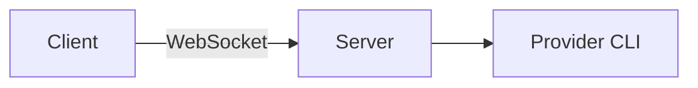

# Diagrams in chat

An agent can answer with a diagram instead of a wall of text. Any code fence tagged
`mermaid` renders as a drawing in the conversation:

````markdown

````

Ask for one the way you would ask for anything else — "draw me the request flow", "diagram
how these modules depend on each other". [Mermaid](https://mermaid.js.org/) covers flowcharts,
sequence diagrams, state machines, entity relationships, class diagrams, Gantt charts, and
more, and every agent T3 Code supports already knows the syntax.

Diagrams follow your theme. The block header has a toggle that flips between the drawing and the
Mermaid text behind it, and the copy button copies that text, ready to paste anywhere else that
speaks Mermaid. Click a diagram to open it full size.

While a reply is still streaming the block shows its source, and the drawing appears once the
reply finishes. A diagram Mermaid cannot draw shows the reason above its source.

Screenshots and other images work differently: an agent writes the file into the workspace and
links it as an ordinary markdown image.

Diagrams render on the web and desktop apps. On mobile a `mermaid` fence stays a code block.
